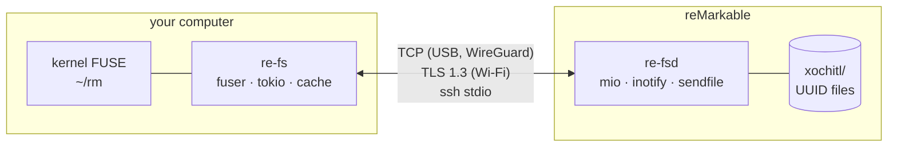

# re-fs documentation

re-fs shows a reMarkable tablet's documents as an ordinary folder tree on your
computer. A small agent on the tablet (`re-fsd`) serves the tablet's document store.
The client (`re-fs`) keeps the whole index in memory, mounts it with FUSE, caches
files, renders handwriting to PDF, and turns `mkdir`, `cp`, `mv` and `rm` into safe
edits on the tablet.

## Features

- The tablet's real folder tree, live: a change on the tablet shows up in about 0.3 s.
- PDFs and EPUBs as files, cached locally; notebooks rendered to PDF.
- `X.annotated.pdf` with your strokes and highlights drawn on, and `X.highlights.md`.
- Lossless `.rmdoc` copies, plus `.recent`, `.pinned` and `.tags/<tag>` views.
- Copy PDFs and EPUBs in, move, rename, trash; nothing is deleted for good.
- A lossless round trip: PDFs re-fs makes carry the whole document, so copying one
  back restores it with its strokes and page order.
- USB, Wi-Fi (TLS 1.3 with your ssh key), WireGuard or ssh; works offline from the cache.

## User guide

| Page | What it covers |
|---|---|
| [Installation](guide/installation.md) | packages, Nix, putting the agent on the tablet, tablet models |
| [Mounting](guide/mounting.md) | what's in the mount, copying/moving/deleting, every mount option |
| [Connecting](guide/connecting.md) | USB, Wi-Fi with TLS keys, WireGuard, ssh; which to choose |
| [Auto-mount on USB](guide/auto-mount.md) | mounting whenever the tablet is plugged in (NixOS or any systemd distribution) |
| [Commands](guide/commands.md) | `mount`, `ls`, `push`, `deploy`, `pair` |
| [Troubleshooting](guide/troubleshooting.md) | error messages and fixes |

## How it works

| Page | What it covers |
|---|---|
| [Architecture](internals/architecture.md) | the four crates, threads, data flow |
| [reMarkable storage format](internals/storage-format.md) | how the tablet stores folders, documents, pages and strokes |
| [Wire protocol](internals/wire-protocol.md) | frames, messages, index deltas, change events |
| [Transports and security](internals/transports-and-security.md) | the tablet service, who may connect, TLS with ssh keys, the two TLS backends |
| [Writes and plans](internals/writes-and-plans.md) | how filesystem actions become tablet edits |
| [Rendering](internals/rendering.md) | v5/v6 stroke parsing, notebooks, annotated PDFs, highlights |
| [Caching and offline](internals/caching-and-offline.md) | downloads, generated files, the saved index |

## Development

| Page | What it covers |
|---|---|
| [Building](development/building.md) | Nix, crane, the agents for each CPU and TLS backend |
| [Releases](development/releases.md) | CI, release files, cutting a release |
| [Testing](development/testing.md) | what the tests cover and how to run them |
| [Working without the tablet](development/without-the-tablet.md) | a local mirror of the tablet's files |
| [Measurements](development/measurements.md) | benchmarks taken on a real reMarkable 2 |

## Design

| Page | What it covers |
|---|---|
| [Design decisions](design/decisions.md) | every decision, the alternatives, and why |
| [Plan: incremental PDFs](design/plan-incremental-pdf.md) | parked: annotated PDFs that load while you scroll |

## Quick references

One-page summaries for working on the code:
[wire protocol](reference/protocol.md) · [xochitl on-disk format](reference/xochitl-format.md).

## Status

| | |
|---|---|
| Folder tree, live updates, PDF/EPUB reads, cache, offline mount | done |
| Writes (mkdir, copy in, move, trash), `push` | done |
| TCP over USB, TLS over Wi-Fi, WireGuard, socket-activated service | done |
| Notebooks, annotated PDFs, highlights, `.rmdoc`, views, xattrs | done |
| OpenSSL / rustls TLS backends; reMarkable 1/2 and Paper Pro agents | done |
| USB auto-mount (NixOS, home-manager, other systemd distributions) | done |
| Mounting on Windows (WinFsp) | not yet |
| Page templates, typed text | not yet |
| ssh-agent / passphrase-protected keys | not yet |
| Trash restore/purge | not yet |
