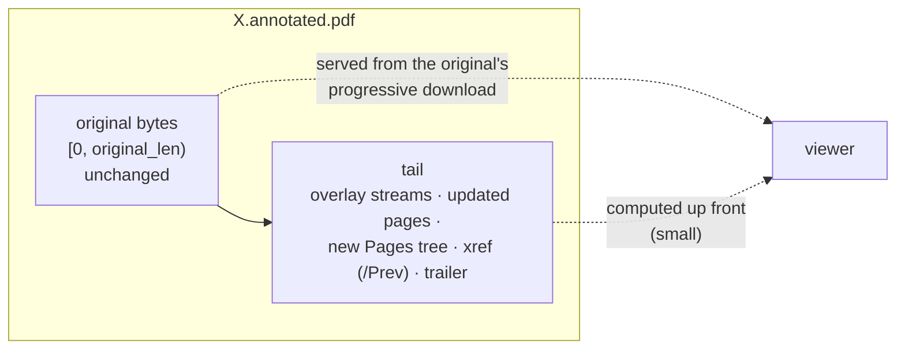
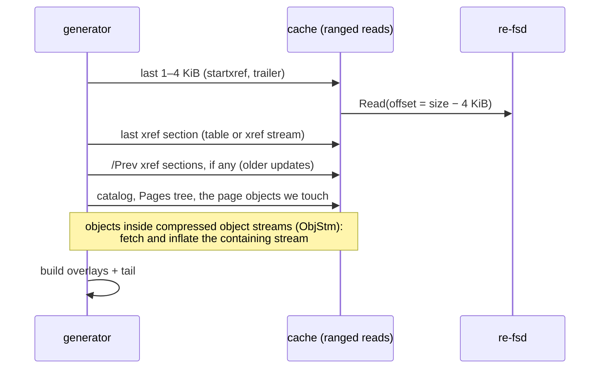

# Plan: annotated PDFs that load while you scroll

> **Parked.** A design note, not implemented. Un-park when big annotated PDFs over
> slow links (WireGuard) become a common case; see [When to un-park](#when-to-un-park).

## The problem

`X.annotated.pdf` is made by rewriting the whole original with lopdf
([Rendering](../internals/rendering.md)). The rewrite needs the complete original, so nothing can be
served until the whole PDF has been downloaded and rewritten:

| Link | 16 MB annotated PDF, first byte |
|---|---|
| USB (23 MiB/s) | about 1–2 s (download + rewrite) |
| WireGuard (about 2 MiB/s) | 8 s or more before anything shows |

Original PDFs don't have this problem: viewers read in pieces and re-fs serves pieces
of a file that's still downloading ([Caching and offline](../internals/caching-and-offline.md)), so
they open almost at once.

## The idea: a PDF incremental update

PDF lets a file be extended without rewriting it (an *incremental update*): new or
replacement objects are appended after the original bytes, followed by a new
cross-reference (xref) section whose `/Prev` points at the original one, and a new
trailer. Readers start from the last trailer and follow `/Prev` for everything else.

The tail holds:

- one **overlay content stream** per annotated page (the strokes, as now);
- an **updated page object** for each page we touch: `/Contents` becomes
  `[q, original…, Q, overlay]`, `/Resources` gains our `ExtGState` (translucent
  highlighter), and the `/Parent` points at the new page tree;
- a **new Pages tree** in the tablet's page order, including blank pages inserted on
  the tablet (new page objects with their own canvas);
- an **xref section** for the new objects with `/Prev` = the original's last xref
  offset, and a **trailer** (new `/Root` → a catalog copy pointing at the new Pages
  tree, `/Size`, `/Prev`).

Reads of `[0, original_len)` are served by the existing cache: ranged reads of the
original while it downloads, exactly as for `X.pdf`. Reads past `original_len` come
from the computed tail. A side benefit: the original's bytes, and so any signatures or
features lopdf doesn't round-trip, are kept as they are.

## What computing the tail needs (without the whole original)

1. **The end of the file:** `startxref` and the trailer (one ranged read of the last
   few KiB).
2. **The xref:** either a classic table (text, fixed 20-byte entries) or an xref
   stream (PDF 1.5+, Flate-compressed, `/W` field widths); follow `/Prev` chains for
   files that already have incremental updates; handle hybrid files (`/XRefStm`).
3. **The objects we need:** catalog, the Pages tree (including inherited
   `/MediaBox`, `/CropBox`, `/Resources`, `/Rotate`), and each page object the tablet
   shows. Some live inside **compressed object streams** (`/Type /ObjStm`): fetch the
   containing stream, inflate it, read its offset table.
4. **Encrypted PDFs:** out of scope; fall back to the full rewrite.

**Round trips.** Roughly 3–5 sequential ranged reads (end of file → xref chain →
page tree → page objects), each a few KiB to a few hundred KiB, independent of file
size; requests within a step can be pipelined. Over WireGuard that's a few hundred ms
instead of the full download.

**Parser.** Two options:

- A **small purpose-built parser** for the pieces above: PDF tokens (numbers, names,
  strings, arrays, dicts, `R` references), indirect objects at an offset, xref tables
  and streams, ObjStm. A few hundred lines, but it has to be tolerant the way viewers
  are.
- **lopdf on fragments**: lopdf can parse individual objects from a byte slice, but its
  xref and object-stream handling assume the whole file. Likely usable for object
  bodies, not for navigation.

The likely answer is our own navigation (xref, ObjStm, offsets) plus lopdf's object
parser for dictionaries, and lopdf's writer for the tail's objects.

## Fallbacks

Anything the incremental path can't handle goes to the current full rewrite, which
already repairs broken PDFs ([Rendering](../internals/rendering.md), decision D40):

| Case | Cheap detection |
|---|---|
| Junk (e.g. a UTF-8 BOM) before `%PDF-` | first 1 KiB doesn't start with `%PDF-` |
| Truncated or missing `%%EOF` | last 1 KiB has no `%%EOF` |
| Broken xref (offsets that don't land on `N G obj`) | check the first object we read at an xref offset |
| Encrypted (`/Encrypt` in the trailer) | trailer dictionary |
| Anything that doesn't parse | parser error |

All of these are visible in the first one or two ranged reads, so falling back costs
little.

## Viewer behaviour

- Viewers (Chromium/pdfium, poppler-based ones, MuPDF) read the **trailer and xref
  first**, then pages on demand. With an incremental update the trailer is in the
  tail (already computed), and early pages' objects are usually near the start of the
  original, so the first page appears after a handful of small reads, not the whole
  download.
- **The file size must be known up front:** `original_len + tail_len`. Since stats now
  make generated files so the size is real, the tail must be computed before the
  stat answers. That's cheap (the reads above), unlike the full rewrite.
- Linearized ("fast web view") originals don't need special handling: an incremental
  update on top of them is still valid, the linearization hints just become stale and
  viewers ignore them.

## Notebooks don't need this

Notebook PDFs are rendered from stroke files, which are small. Since `ReadPages`
batching they're bandwidth-bound, not round-trip-bound: a 284-page notebook over
WireGuard went from 165 s to 31 s, and after a one-page edit it's re-made in 4 s
(only the changed page is fetched). See [Measurements](../development/measurements.md).

## Effort and risks

**Effort:** a few days: the navigation parser and ObjStm (most of it), the tail
writer, wiring into the generator and the cache's ranged reads, and the test corpus.

**Risks:**

- PDFs in the wild are messy; a tolerant parser takes iteration (the fallback limits
  the damage to "slower", never "wrong").
- Page objects shared between pages, or a page shown twice by the tablet, need copies
  in the tail (the full rewrite already does this).
- Inherited attributes must be resolved through the original's page tree, which may
  be deep.
- Two code paths for one output: keep their rendering identical (same overlay
  streams and placement).

## Test plan

- **Prefix equality:** the first `original_len` bytes of the output equal the
  original, byte for byte.
- **Render comparison:** rasterize the incremental output and the current full
  rewrite (e.g. poppler at low DPI) and compare page by page; they must match.
- **Validity:** poppler, MuPDF and pdfium open every output; `qpdf --check` passes.
- **Fallback corpus:** the repaired cases (BOM, truncated `%%EOF`, broken xref),
  encrypted PDFs, xref streams, ObjStm-heavy PDFs, PDFs with existing incremental
  updates; each either takes the incremental path correctly or falls back.
- **Timing:** time to first page over WireGuard for a 16 MB annotated PDF, before and
  after.

## When to un-park

- Big annotated PDFs opened over WireGuard (or another slow link) become a common
  case, or
- the full-rewrite wait (8 s+ for 16 MB over WireGuard) shows up as a real annoyance.

Until then the full rewrite is simpler, already handles broken PDFs, and over USB
costs 1–2 s for a 16 MB PDF.
