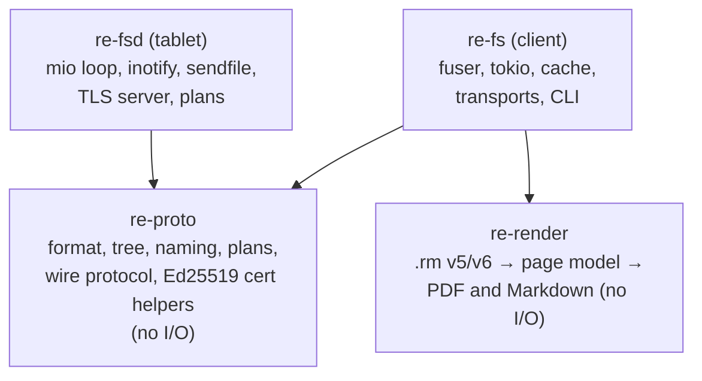
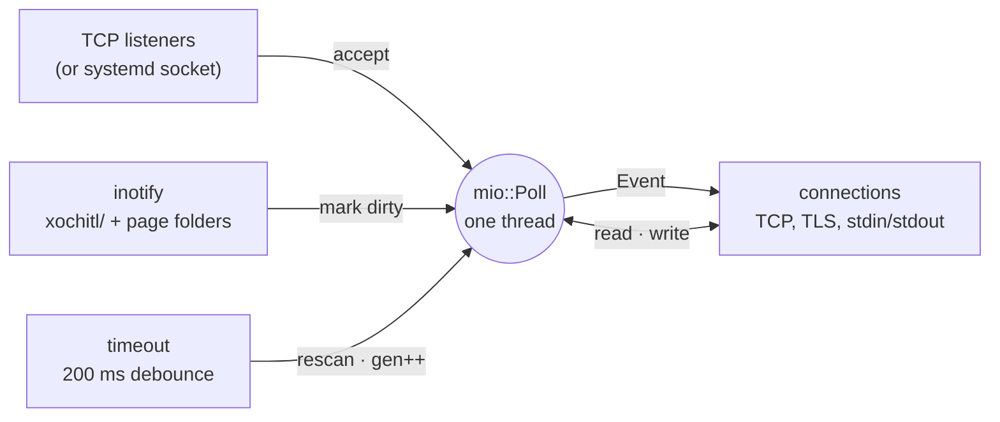
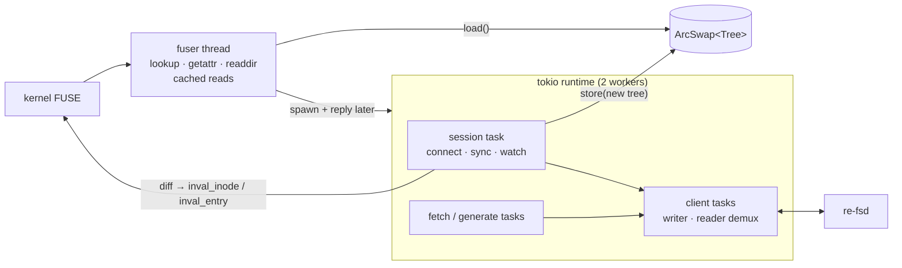
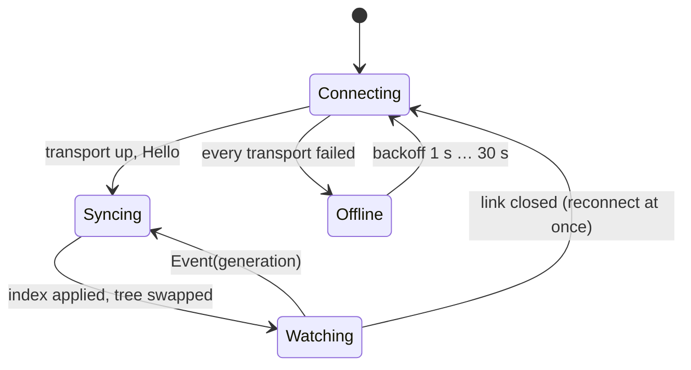

# Architecture

Four crates in one Cargo workspace.



| Crate | Runs on | Async? | Main dependencies |
|---|---|---|---|
| re-proto | both | none (sans-io) | serde, postcard, lz4_flex, uuid; feature `json` adds serde_json |
| re-render | client | none | lopdf |
| re-fsd | tablet (and x86 for tests); library + binary | no: one mio thread | mio, inotify, rustix, lexopt; TLS: openssl (feature `openssl`, default) or rustls + ring + rcgen (feature `rustls`) |
| re-fs | your machine | tokio | fuser (no libfuse), tokio, tokio-rustls, arc-swap, clap, zstd, zip |

## re-proto

- `index::entry`: what the agent sends per item: raw `.metadata`/`.content` bytes,
  stats of `.metadata`, `.content`, `.pdf`, `.epub`, `.pagedata`, and the page
  folder's files.
- `index::parse`: typed views of `.metadata` and `.content` (both page-list formats).
  `ContentKind` reads only `fileType`, `pageCount` and `tags`, skipping page lists
  without allocating: tree rebuilds went from ~50 ms to 2.9 ms for 380 items.
- `index::naming`: filenames from `visibleName` (see below).
- `index::tree`: the immutable tree, views, inodes, and `diff` for kernel
  invalidations.
- `index::plan`: filesystem actions → tablet writes (see
  [Writes and plans](writes-and-plans.md)).
- `wire`: frames, messages, the sans-io `FrameDecoder` (see
  [Wire protocol](wire-protocol.md)).
- `tlsid`: Ed25519 keys inside self-signed certificates, PKCS#8 encoding, hex.

### The tree

The tree is rebuilt from scratch on every change and swapped in atomically. Items are
parsed, folders resolved by `parent`, orphans go to `/.lost+found`, and folder cycles
are broken by moving one folder there.

```
/                       the tablet's folders; each document once:
  X.pdf                   a PDF (original)
  X.annotated.pdf         … with strokes drawn on (if it has any)
  X.highlights.md         … highlights as Markdown (PDF/EPUB with annotations)
  Y.epub                  an EPUB (original)
  Z.pdf                   a notebook, rendered
/.trash  /.lost+found
/.originals/…           the folders again, original PDFs/EPUBs only
/.rmdoc/…               the folders again, every document as X.rmdoc
/.recent                last 50 opened (mtime = when last opened)
/.pinned                favourites
/.tags/<tag>            documents by tag
```

**Naming rules**

- `/` becomes `∕` (U+2215); NUL is dropped; empty becomes `Untitled`.
- The type's extension is added only if the name doesn't already end with it
  (ASCII case-insensitive).
- Clashes get ` (2)`, ` (3)` in a stable order: oldest `createdTime` first, then UUID.
- Names are cut to 255 bytes without splitting a character or losing the extension.
- `.trash`, `.lost+found`, `.originals`, `.rmdoc`, `.recent`, `.pinned`, `.tags` are
  reserved at the top level; a tablet folder with one of those names is numbered.

**Inodes** come from the UUID (two halves XORed, kept positive, out of the reserved
range 0–15), so a document keeps its inode across remounts. A main-tree document
keeps exactly the inode it had before views existed; every other (document, view,
variant) gets a salted variant. Collisions are probed upward.

## re-fsd (agent)



- Keeps every item's raw JSON and stats in memory (~10 MB); a generation counter goes
  up on every change, with tombstones for deltas.
- inotify events mark UUIDs dirty; they're rescanned 200 ms after the last event of a
  burst, at most 1 s after the first. A queue overflow rescans everything.
- Reads use `sendfile()` on plain links, so file bytes never pass through user space.
  On TLS links file data goes through the TLS session in 64 KiB chunks.
- Paths are only ever built from a parsed UUID plus an enum (`FileKind`) or a
  validated page-file name, so a request can't name anything outside `xochitl/`.
- `--stdio` runs the same loop over stdin/stdout, which is how `ssh HOST re-fsd
  --stdio` works.
- With `--idle-exit SECS` it exits once nobody has been connected that long (socket
  activation starts it again).

## re-fs (client)



- FUSE stays synchronous. Anything answerable from the tree or the cache is answered
  on the fuser thread; anything slow is spawned on tokio, which replies later (fuser
  reply objects can move between threads).
- The client pipelines requests: a writer task assigns request ids, a reader task
  routes replies (one-shot replies, streamed events) by id.
- The session task connects (trying transports in order), fetches the index (a delta
  when it can), follows change events, rebuilds the tree, diffs it against the old
  one and sends the kernel invalidations.



If the first connection fails and a saved index exists, the mount comes up offline
from it (see [Caching and offline](caching-and-offline.md)).
