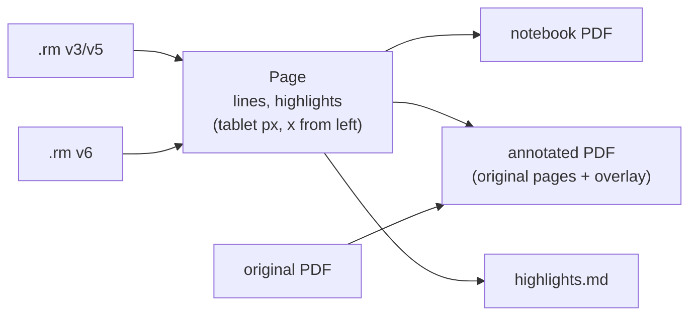
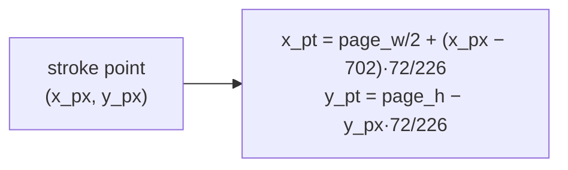

# Rendering

`re-render` is a pure crate: `.rm` bytes in, a page model out; page models in, PDF or
Markdown bytes out.



## The page model

- `Point { x, y, width (px), pressure (0..1) }`, x 0..1404 from the left (v6 adds
  702), y from the top.
- `Line { tool, color, thickness_scale, points }`.
- `Highlight { text, color, rects }` (v6 glyph items).

v6 eraser paths are dropped (erasing already removed the strokes). v5 eraser lines
are kept and drawn white, as v5 itself did.

## Drawing strokes

- Each stroke is split into runs of similar width (within 15%); each run is one PDF
  path with round caps and joins, at the run's average width.
- Pencils draw a little thinner; highlighter and shader draw translucent
  (`CA`/`ca` 0.45, Multiply) with square caps.
- Highlight rectangles are filled translucent under the strokes.
- Not drawn yet: page templates (ruled lines), typed text, strokes anchored to typed
  text (drawn where stored).

## Notebooks

One PDF page per tablet page at 72/226 pt per px (1404 × 1872 px →
447.3 × 596.4 pt). Pages are an open canvas, so each page grows to hold every stroke
plus a 10 px margin. Blank pages stay screen-sized.

## Annotated PDFs

The original PDF is loaded with lopdf and rebuilt in the tablet's page order:

1. For each tablet page: `redir` gives the original page; no `redir` means a page
   inserted on the tablet.
2. Original pages get their inherited attributes (Resources, MediaBox, CropBox,
   Rotate) copied in, so they survive being moved out of nested page trees.
3. The original content is wrapped in `q … Q` and an overlay content stream is
   appended, with an ExtGState for translucent tools.
4. Inserted pages are new canvas pages (as for notebooks).
5. A page shown twice gets a copy; unused pages are pruned.

### Where strokes go on a PDF page



Strokes are stored at 226 dpi relative to the page's centre line and top, whatever
the zoom. This was found by comparing renders of a real annotated A4 page with
xochitl's own thumbnail of it:

| Model | Result |
|---|---|
| page fitted to the whole screen, centred (first guess) | ink drifted down the page |
| page fitted to the screen's width | ink drifted down; the lowest strokes fell off the page |
| physical 226 dpi, centred x | matched the thumbnail stroke for stroke |

### Broken PDFs

Viewers repair some broken PDFs silently; lopdf doesn't. Before annotating, re-fs
tries in order:

1. the file as is;
2. junk before `%PDF-` (seen: a UTF-8 BOM) removed, for files whose offsets don't
   count it;
3. the header moved to byte 0 with the gap filled by a comment line, for files whose
   offsets do;
4. each of those with a truncated `%%E…` completed (or `%%EOF` added) without adding
   a blank line (lopdf reads the last lines strictly);
5. last resort: a new cross-reference table built from every `N G obj` in the file,
   appended with a trailer that keeps `/Root` and `/Info`.

A real document had a BOM added after it was written, offsets that didn't count it,
and a file ending in `%%E`; it needed step 4 or 5.

## Highlights as Markdown

One section per page that has highlights or drawings, highlights in reading order
(top to bottom, then left to right), whitespace collapsed:

```markdown
# Paper

## Page 3

> first highlighted passage

*Handwritten notes on this page.*
```

## Checked against real pages

| Page | Result |
|---|---|
| Sample (v6 notebook, "a handwritten line") | matches the tablet's thumbnail |
| Annotated A4 PDF page (v6) | matches the thumbnail after the placement fix |
| Inserted page in a PDF (v6, strokes beyond the screen) | complete, page grown |
| v5 notebook page, 897 ballpoint strokes | renders correctly |
| two v5 pages with only eraser strokes | blank, as are their thumbnails |
