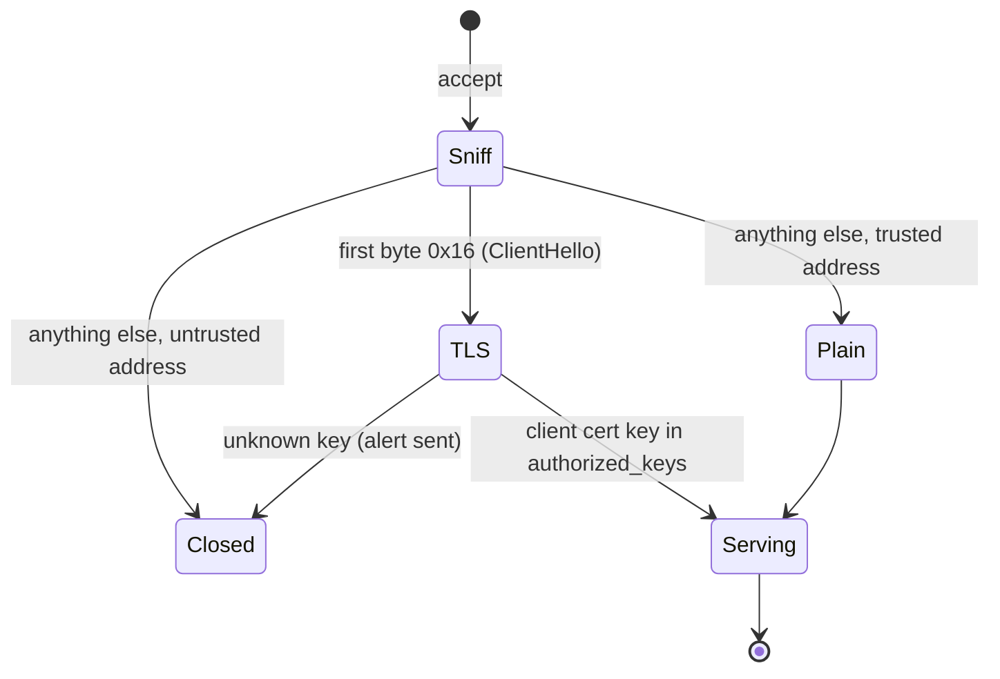
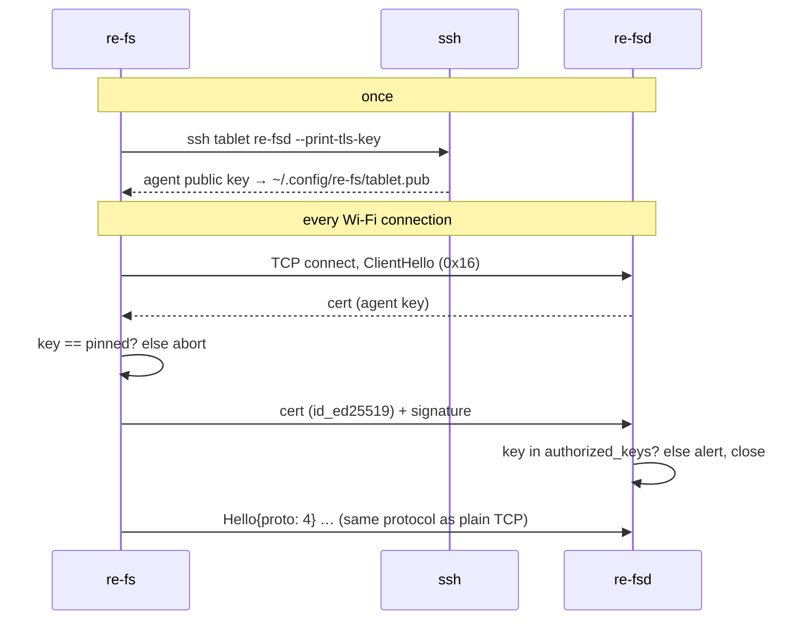

# Transports and security

How the client reaches the agent, how the tablet service is set up, and who may
connect. Choosing a transport as a user is covered in
[Connecting](../guide/connecting.md).

## Transports

| Flag | Path | Encryption | Notes |
|---|---|---|---|
| `--usb` | TCP to 10.11.99.1:7745 | none (a cable) | tried only while a reMarkable USB network is up |
| `--tls ADDR` | TLS 1.3 to the agent | TLS | for Wi-Fi, e.g. `192.168.1.50:7745` |
| `--tcp ADDR` | plain TCP | none | only accepted from trusted addresses: WireGuard via wireproxy (`10.0.0.5:7745`) |
| `--ssh HOST` | `ssh HOST re-fsd --stdio` | ssh | works with no service installed |

Several can be given. Each time re-fs connects it tries them in the order USB, each
`--tls`, each `--tcp`, then `--ssh`, and stays on whichever link it got until that
link drops. It never switches links mid-session.

**USB detection**: a network interface whose `/sys/class/net/<if>/device` resolves
into a USB device and which has an address on 10.11.99.x (other than .1, the tablet).
The tablet's DHCP hands out a /27.

## The tablet service

`re-fs deploy root@10.11.99.1 --service` installs:

```
/home/root/re-fs/re-fsd            the agent (armv7 on a reMarkable 1/2, aarch64 on a Paper Pro; both use the tablet's OpenSSL)
/home/root/re-fs/re-fsd.socket     systemd socket, port 7745
/home/root/re-fs/re-fsd.service    started by the socket
/home/root/re-fs/install.sh        copies both units into /etc/systemd/system
/home/root/re-fs/tls.key           the agent's TLS key (created on first use, 0600)
```

The service runs:

```
re-fsd --allow-local 127.0.0.1 --allow-local 10.11.99.1 \
       --tls-key /home/root/re-fs/tls.key --idle-exit 300
```

- systemd holds the port and starts re-fsd on the first connection (about 0.3 s);
  re-fsd exits after 5 minutes with no clients.
- OS updates reset `/etc`: run `sh /home/root/re-fs/install.sh` afterwards (or call it
  from the tablet's existing `/home/root/wireproxy/reinstall.sh`).
- WireGuard: one `[TCPServerTunnel]` entry in wireproxy's config exposes the agent on
  the tablet's VPN address; those connections arrive from 127.0.0.1.

## Who may speak what



- A connection is trusted if it reached the agent on an `--allow-local` address
  (USB, loopback). systemd's socket is dual-stack, so IPv4 clients arrive as
  `::ffff:a.b.c.d`; the agent canonicalises before comparing.
- TLS and plain share port 7745; the first byte decides.

## TLS: ssh keys as identities

TLS 1.3 only, with the tablet's OpenSSL by default or rustls + ring (see below). The client always uses rustls. Both sides present self-signed
certificates for Ed25519 keys; no certificate authority is involved.

- **Client identity**: re-fs builds a certificate from `~/.ssh/id_ed25519` (or
  `--identity`). The agent extracts the key and accepts it only if it's an
  unrestricted `ssh-ed25519` line in `/home/root/.ssh/authorized_keys`, re-read on
  every handshake. Lines with options (`command=`, `from=`) are ignored. Removing a
  key there revokes re-fs access at once, as for ssh.
- **Tablet identity**: the agent's own key, `/home/root/re-fs/tls.key`. re-fs accepts
  only the key pinned in `~/.config/re-fs/tablet.pub`. `re-fs pair HOST` (and
  `re-fs deploy HOST --service`) fetch it over ssh with `re-fsd --print-tls-key`, so
  ssh authenticates the pin once.
- **Cipher**: the agent prefers ChaCha20-Poly1305 and ignores the client's order. The
  Cortex-A7 has no AES instructions; with AES-GCM, TLS over USB ran at 10 MiB/s, with
  ChaCha20 at 18 MiB/s.



Passphrase-protected keys and ssh-agent aren't supported yet.

## Two TLS backends

re-fsd's TLS sits behind one buffer-oriented `tls::Session`
(`crates/re-fsd/src/tls/{mod,rustls,openssl}.rs`), with two implementations chosen
at compile time:

| Cargo feature | Library | Agent binary | Notes |
|---|---|---|---|
| `openssl` (default) | the tablet's own OpenSSL 3 (`/usr/lib/libssl.so.3`, `libcrypto.so.3`; 3.5.6, also used by xochitl and rm-sync) | 788 KB, dynamic glibc | the OpenSSL session runs over an in-memory pipe so the mio loop stays the same |
| `rustls` | rustls + ring, statically linked | 2.38 MB, static musl | no run-time dependencies |

Both are TLS 1.3 only, prefer ChaCha20-Poly1305, check client certificates against
`authorized_keys` (OpenSSL through a verify callback), and use the same `tls.key`
file format, so the pinned key survives switching backends. Measured over USB, TLS
ran at 23 MiB/s with OpenSSL and 19 MiB/s with rustls. See
[Build and cross-compilation](../development/building.md).
