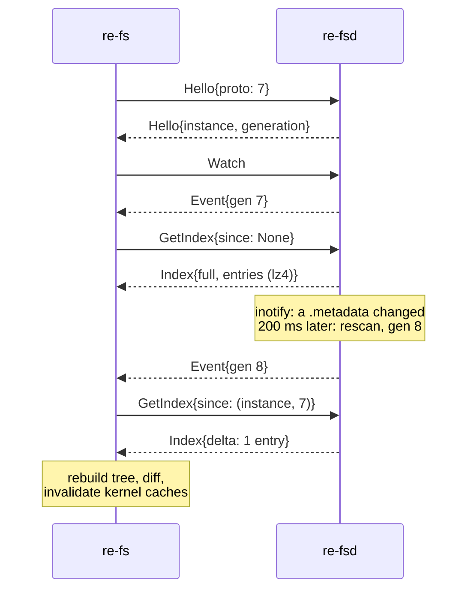
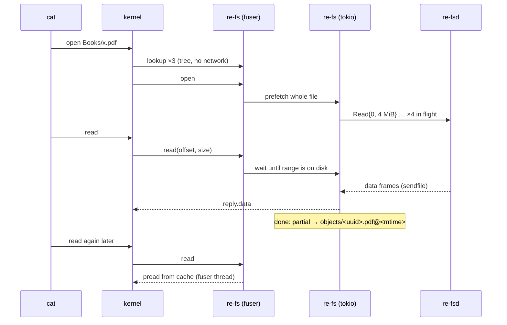

# Wire protocol (version 7)

One byte stream per connection: plain TCP, TLS 1.3, or `ssh HOST re-fsd --stdio`. The
protocol inside is the same on all of them.

## Frames

```
len: u32 LE | kind: u8 | req_id: u32 LE | payload (len bytes)
```

- kind 1, **message**: postcard-encoded `Request` or `Response`.
- kind 2, **data**: raw file bytes answering a read. The agent writes the 9-byte
  header and then `sendfile`s the range (plain links) or streams it through the TLS session.

Payloads are capped at 64 MiB; one read returns at most 8 MiB. Replies carry the
request's id, so requests are pipelined and may be answered out of order. Events
after `Watch` carry the Watch's id. `FrameDecoder` is sans-io: feed bytes in, get
whole frames out; tests feed it one byte at a time.

## Requests

| Request | Reply |
|---|---|
| `Hello { proto }` | `Hello { proto, agent, instance, generation }` |
| `GetIndex { since: Option<(instance, generation)> }` | `Index { instance, generation, full, removed, entries }` |
| `Read { uuid, file, offset, len, expect_mtime_ms }` | data frame (shorter at EOF), or `Err(Changed / NotFound)` |
| `ReadPage { uuid, name, offset, len, expect_mtime_ms }` | the same, for a file in `<uuid>/` |
| `Watch` | `Event { generation }` now, then on every change |
| `PutChunk { token, offset, data }` | `Ok`; stored in the staging area beside `xochitl/` |
| `Apply { plan }` | `Applied { generation }`, or `Err(Conflict)` with nothing written |

Errors are `Err { code, message }` with code BadRequest, NotFound, Changed, Io,
Unsupported, Conflict or Unauthorized.

## The index

`entries` is lz4 (size-prepended) over postcard `Vec<Entry>`. The agent sends the
raw JSON bytes; it never parses them. The full index of 380 items is ~10 MB of JSON
and ~1.3 MB on the wire.

`instance` changes every time the agent starts; `generation` goes up with every
change. A `GetIndex` with a `since` from the same instance gets a delta: entries
changed after that generation plus removed UUIDs. A rename on the tablet arrived as a
365-byte delta.



## Reading a PDF



## Versions

| Version | Change |
|---|---|
| 1 | first protocol |
| 2 | Hello carried a login challenge; `Auth` (removed in 4) |
| 3 | page files in the index; `ReadPage`; `.pagedata` |
| 4 | Wi-Fi uses TLS; the challenge login is gone |
| 5 | `ReadPages`: several page files in one round trip |
| 6 | the client picks the codec (none, lz4, zstd) per request; replies are chunked |
| 7 | `PutStagedPage` and `.pagedata` in `PutJson`: importing whole documents (`.rmdoc`, or a PDF re-fs made) |
