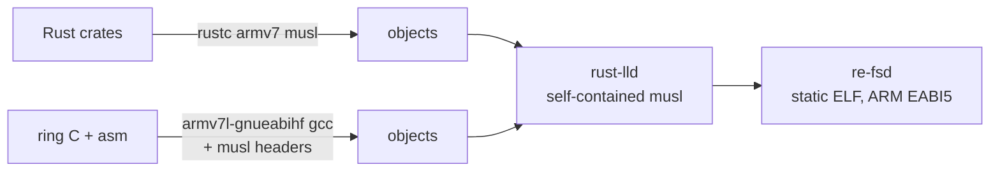

# Build and cross-compilation

```
nix build .#re-fs                  # client; its `deploy` installs the OpenSSL agent
nix build .#re-fs-rustls-agent     # the same client, deploying the static rustls agent
nix build .#re-fsd-armv7           # tablet agent, OpenSSL backend (default): dynamic armv7 glibc
nix build .#re-fsd-armv7-rustls    # tablet agent, rustls backend: static armv7 musl
nix build .#re-fsd                 # agent for x86 (tests, local experiments)
nix flake check                    # tests, tests-rustls, clippy -D warnings, both armv7 agents
nix develop                  # cargo, rust-analyzer, python3
```

The flake uses **crane** with a **fenix** stable toolchain that includes the
`armv7-unknown-linux-musleabihf` standard library.

## The static (rustls) agent

- Target `armv7-unknown-linux-musleabihf`, statically linked: no dependency on the
  tablet's glibc version, survives OS updates.
- Linked by the toolchain's own `rust-lld` with musl's self-contained startup files
  (`.cargo/config.toml`), so pure-Rust code needs no C cross toolchain at all. The
  first agent was 432 KB.
- **ring** (TLS crypto) contains C and assembly. They're compiled by nixpkgs'
  prebuilt ARMv7 GCC (`pkgsCross.armv7l-hf-multiplatform.stdenv.cc`, in the binary
  cache) against **musl's** headers (`pkgsCross.armv7l-hf-multiplatform.musl.dev`),
  with `-nostdinc -isystem <musl>/include -isystem <gcc>/include`. The objects link
  into the same static musl binary. The musl-targeted GCC isn't in the cache; the
  glibc-targeted one is, and only its compiler is used.
- With TLS (rustls) the agent is 1.79 MB; the default OpenSSL agent is 788 KB.



`nix build .#re-fs` embeds the store path of `re-fsd-armv7` (`RE_FSD_ARMV7`), so
`re-fs deploy` installs exactly the agent it was built with. The service files in
`deploy/` are embedded with `include_str!`; the source filter keeps `deploy/` and
`tests/data/` alongside Cargo sources.

## The OpenSSL agent (default)

The tablet already ships OpenSSL 3.5.6 (`/usr/lib/libssl.so.3` 800 KB,
`/usr/lib/libcrypto.so.3` 3.6 MB), used by xochitl and rm-sync. re-fsd has two
cargo features, pick one: `openssl` (default) and `rustls`.

```
nix build .#re-fsd-armv7                                    # OpenSSL agent
cargo build -p re-fsd                                       # OpenSSL (default feature)
cargo build -p re-fsd --no-default-features --features rustls
```

`lib.x86_64-linux.agentFor "openssl" | "rustls"` gives either agent derivation to
other flakes.

The OpenSSL agent is a dynamic **armv7 glibc** binary built against nixpkgs'
(cached) ARMv7 OpenSSL 3.5.9 and glibc, with the interpreter set to
`/lib/ld-linux-armhf.so.3` and no rpath, so on the tablet it loads the system's
libraries:

```
NEEDED  libssl.so.3  libcrypto.so.3  libgcc_s.so.1  libc.so.6
highest symbol version: GLIBC_2.39   (the tablet has glibc 2.39, OpenSSL 3.5.6)
```

It is 788 KB, against 1.79 MB for the static rustls build. Its C (OpenSSL headers)
is compiled with the same cached ARMv7 GCC; there's no ring to cross-compile. The
trade-off: it depends on the tablet's glibc and OpenSSL staying compatible across OS
updates, where the static rustls build depends on nothing.

## Local development without the tablet

`mirror/` (gitignored) holds a copy of the tablet's `.metadata`/`.content` files plus
sparse files with each PDF/EPUB's real size and mtime (see the README). A native
`re-fsd --dir <copy of mirror> --listen 127.0.0.1:7746` serves it, and
`re-fs mount --tcp 127.0.0.1:7746` mounts it, including `--rw`.
