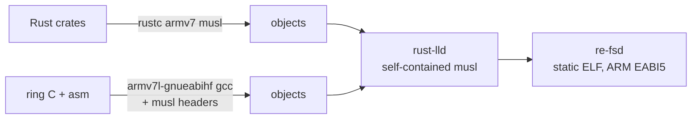

# Build and cross-compilation

```
nix build .#re-fs                  # client; its `deploy` installs the OpenSSL agent
nix build .#re-fs-rustls-agent     # the same client, deploying the static rustls agent
nix build .#re-fsd-armv7           # tablet agent, OpenSSL backend (default): dynamic armv7 glibc
nix build .#re-fsd-armv7-rustls    # tablet agent, rustls backend: static armv7 musl
nix build .#re-fsd                 # agent for x86 (tests, local experiments)
nix build .#re-fs-windows          # Windows client (x86_64 MinGW): ls, push, pair, deploy
nix flake check                    # tests, tests-rustls, clippy -D warnings, both armv7 agents, Windows client
nix develop                  # cargo, rust-analyzer, python3
```

The flake uses **crane** with a **fenix** stable toolchain that includes the
standard libraries for `armv7-unknown-linux-musleabihf`, `armv7-unknown-linux-gnueabihf`
and `x86_64-pc-windows-gnu`.

## Layout

`flake.nix` only wires things together; the builds are in `nix/`, one file per
platform:

| File | What it builds |
|---|---|
| `nix/toolchain.nix` | the fenix toolchain with the cross targets, crane, and the filtered source tree |
| `nix/linux.nix` | x86_64 Linux: `re-fs`, `re-fs-rustls-agent`, the native `re-fsd`, the `tests`/`tests-rustls`/`clippy` checks, the dev shell |
| `nix/tablet.nix` | the reMarkable agent: `re-fsd-armv7` (OpenSSL, default), `re-fsd-armv7-rustls` (static), and `agentFor` |
| `nix/windows.nix` | the Windows client, `re-fs-windows` |
| `nix/nixos.nix`, `nix/home-manager.nix` | the USB auto-mount modules (`nixosModules.default`, `homeManagerModules.default`) |

`linux.nix` takes `agentFor` from `tablet.nix`, because the client embeds the agent
it deploys. The tablet and Windows builds are also checks, so `nix flake check`
builds them.

## The static (rustls) agent

- Target `armv7-unknown-linux-musleabihf`, statically linked: no dependency on the
  tablet's glibc version, survives OS updates.
- Linked by the toolchain's own `rust-lld` with musl's self-contained startup files
  (`.cargo/config.toml`), so pure-Rust code needs no C cross toolchain at all. The
  first agent was 432 KB.
- **ring** (TLS crypto) contains C and assembly. They're compiled by nixpkgs'
  prebuilt ARMv7 GCC (`pkgsCross.armv7l-hf-multiplatform.stdenv.cc`, in the binary
  cache) against **musl's** headers (`pkgsCross.armv7l-hf-multiplatform.musl.dev`),
  with `-nostdinc -isystem <musl>/include -isystem <gcc>/include`. The objects link
  into the same static musl binary. The musl-targeted GCC isn't in the cache; the
  glibc-targeted one is, and only its compiler is used.
- With TLS (rustls) the agent is 1.79 MB; the default OpenSSL agent is 788 KB.



`nix build .#re-fs` embeds the store path of `re-fsd-armv7` (`RE_FSD_ARMV7`), so
`re-fs deploy` installs exactly the agent it was built with. The service files in
`deploy/` are embedded with `include_str!`; the source filter keeps `deploy/` and
`tests/data/` alongside Cargo sources.

## Without Nix

`tools/build.sh [--prefix DIR]` builds the same static rustls agent and the client
on an ordinary distribution. It needs rustup, a host C compiler, clang, curl and make:

```sh
sudo pacman -S --needed rustup base-devel clang curl fuse3 openssh           # Arch
sudo apt-get install rustup build-essential clang curl fuse3 openssh-client  # Debian 13, Ubuntu 24.04
sudo dnf install rustup gcc clang curl make fuse3 openssh-clients           # Fedora
sudo zypper in rustup gcc clang curl make fuse3 openssh-clients             # openSUSE Tumbleweed
sudo apk add rustup build-base clang curl fuse3 openssh-client              # Alpine
```

It does what `tablet.nix` does, using other tools:

| | Nix | `tools/build.sh` |
|---|---|---|
| Rust + armv7 musl std | fenix | `rustup target add armv7-unknown-linux-musleabihf` (minimal profile) |
| musl headers | `armPkgs.musl.dev` | musl 1.2.5 source, `make ARCH=arm install-headers` (no compiler), cached in `target/musl-headers` |
| C compiler for ring/zstd | nixpkgs' ARMv7 GCC | host `clang` (cc-rs passes `--target=armv7-unknown-linux-musleabihf`) with `-nostdinc -isystem <musl>/include -isystem <clang resource dir>/include` |
| Archiver | ARMv7 binutils | `llvm-ar` if installed, else `ar` |
| Linker | rust-lld, self-contained musl (`.cargo/config.toml`) | same |
| `RE_FSD_ARMV7` | the agent's store path | `DIR/lib/re-fs/re-fsd` with `--prefix`, otherwise `target/…/re-fsd` |

`RE_FSD_ARMV7` is a path read when `deploy` runs (the agent isn't embedded), so with
`--prefix` the agent is installed first and the client is built pointing at it.

Tested in clean `archlinux`, `debian:trixie`, `ubuntu:24.04`, `fedora`,
`opensuse/tumbleweed` and `alpine` containers: each produces an x86-64
`re-fs` and a statically linked ARM EABI5 `re-fsd` of 2.25–2.4 MB (against 1.79 MB
from Nix; not looked into yet). The OpenSSL agent isn't covered.
It would need an ARMv7 OpenSSL and zstd to link against, and a glibc no newer than
the tablet's 2.39, which rules out linking against Debian 13's 2.41 armhf libraries.

## The OpenSSL agent (default)

The tablet already ships OpenSSL 3.5.6 (`/usr/lib/libssl.so.3` 800 KB,
`/usr/lib/libcrypto.so.3` 3.6 MB), used by xochitl and rm-sync. re-fsd has two
cargo features, pick one: `openssl` (default) and `rustls`.

```
nix build .#re-fsd-armv7                                    # OpenSSL agent
cargo build -p re-fsd                                       # OpenSSL (default feature)
cargo build -p re-fsd --no-default-features --features rustls
```

`lib.x86_64-linux.agentFor "openssl" | "rustls"` gives either agent derivation to
other flakes.

The OpenSSL agent is a dynamic **armv7 glibc** binary built against nixpkgs'
(cached) ARMv7 OpenSSL 3.5.9 and glibc, with the interpreter set to
`/lib/ld-linux-armhf.so.3` and no rpath, so on the tablet it loads the system's
libraries:

```
NEEDED  libssl.so.3  libcrypto.so.3  libzstd.so.1  libgcc_s.so.1  libc.so.6
highest symbol version: GLIBC_2.39   (the tablet has glibc 2.39, OpenSSL 3.5.6)
```

It is 788 KB, against 1.79 MB for the static rustls build. It also links the
tablet's `libzstd.so.1` (1.5.5) for zstd-compressed replies, built against nixpkgs'
cached ARMv7 zstd; the rustls build compiles zstd in. Its C (OpenSSL headers) is
compiled with the same cached ARMv7 GCC; there's no ring to cross-compile. The
trade-off: it depends on the tablet's glibc and OpenSSL staying compatible across OS
updates, where the static rustls build depends on nothing.

## Local development without the tablet

`mirror/` (gitignored) holds a copy of the tablet's `.metadata`/`.content` files plus
sparse files with each PDF/EPUB's real size and mtime (see the README). A native
`re-fsd --dir <copy of mirror> --listen 127.0.0.1:7746` serves it, and
`re-fs mount --tcp 127.0.0.1:7746` mounts it, writes included.
