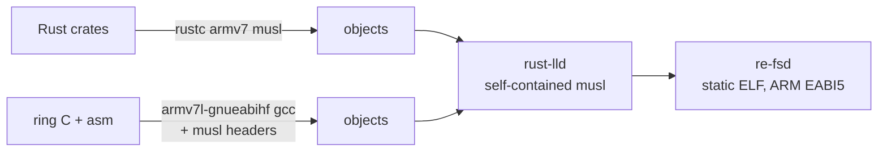

# Build and cross-compilation

```
nix build .#re-fs                  # client; its `deploy` installs the OpenSSL agent (rM1/2) or the aarch64 one
nix build .#re-fs-rustls-agent     # the same client, deploying a static rustls agent on every model
nix build .#re-fsd-armv7           # rM1/2 agent, OpenSSL backend (default): dynamic armv7 glibc
nix build .#re-fsd-armv7-rustls    # rM1/2 agent, rustls backend: static armv7 musl
nix build .#re-fsd-aarch64         # Paper Pro agent, rustls backend: static aarch64 musl
nix build .#re-fsd                 # agent for x86 (tests, local experiments)
nix build .#re-fs-windows          # Windows client (x86_64 MinGW): ls, push, pair, deploy
nix flake check                    # tests, tests-rustls, clippy -D warnings, all three tablet agents, Windows client
nix develop                  # cargo, rust-analyzer, python3
```

The flake uses **crane** with a **fenix** stable toolchain that includes the
standard libraries for `armv7-unknown-linux-musleabihf`, `armv7-unknown-linux-gnueabihf`,
`aarch64-unknown-linux-musl` and `x86_64-pc-windows-gnu`.

## Tablet models: one client, an agent per CPU

The reMarkable 1 and 2 are 32-bit ARM (armv7); the Paper Pro and Paper Pro Move are
64-bit ARM (aarch64). The CPU isn't chosen when re-fs is built. Every build makes an
agent for both, and the client carries both (`RE_FSD_ARMV7` and `RE_FSD_AARCH64`,
embedded by `crates/re-fs/build.rs`). `re-fs deploy` decides when it runs:

1. It runs `uname -m; tr -d '\0' < /proc/device-tree/model` over ssh (one extra
   handshake, about 0.3 s on USB) and prints e.g. `root@10.11.99.1 is a reMarkable 2.0 (armv7l)`.
2. `armv7*` picks the armv7 agent and `aarch64` the aarch64 one. Anything else is
   refused.
3. Before sending, it reads the chosen binary's ELF header (`e_machine` 40 = ARM,
   183 = AArch64) and refuses one built for a different CPU. This also covers a
   `--binary` given by hand.

`uname -m` and not the model name decides, because the model strings of the newer
tablets aren't verified here, while `uname -m` is the same on any Linux. The Paper
Pro gets the static rustls agent: nothing has checked its OS's glibc and OpenSSL, and
the static build doesn't depend on them.

## Layout

`flake.nix` only wires things together; the builds are in `nix/`, one file per
platform:

| File | What it builds |
|---|---|
| `nix/toolchain.nix` | the fenix toolchain with the cross targets, crane, and the filtered source tree |
| `nix/linux.nix` | x86_64 Linux: `re-fs`, `re-fs-rustls-agent`, the native `re-fsd`, the `tests`/`tests-rustls`/`clippy` checks, the dev shell |
| `nix/tablet.nix` | the tablet agents: `re-fsd-armv7` (OpenSSL, default), `re-fsd-armv7-rustls` (static), `re-fsd-aarch64` (static, Paper Pro), and `agentFor` |
| `nix/windows.nix` | the Windows client, `re-fs-windows` |
| `nix/nixos.nix`, `nix/home-manager.nix` | the USB auto-mount modules (`nixosModules.default`, `homeManagerModules.default`) |

`linux.nix` takes `agentFor` from `tablet.nix`, because the client embeds the agent
it deploys. The tablet and Windows builds are also checks, so `nix flake check`
builds them.

## The static (rustls) agent

- Target `armv7-unknown-linux-musleabihf`, statically linked: no dependency on the
  tablet's glibc version, survives OS updates.
- Linked by the toolchain's own `rust-lld` with musl's self-contained startup files
  (`.cargo/config.toml`), so pure-Rust code needs no C cross toolchain at all. The
  first agent was 432 KB.
- **ring** (TLS crypto) contains C and assembly. They're compiled by nixpkgs'
  prebuilt ARMv7 GCC (`pkgsCross.armv7l-hf-multiplatform.stdenv.cc`, in the binary
  cache) against **musl's** headers (`pkgsCross.armv7l-hf-multiplatform.musl.dev`),
  with `-nostdinc -isystem <musl>/include -isystem <gcc>/include`. The objects link
  into the same static musl binary. The musl-targeted GCC isn't in the cache; the
  glibc-targeted one is, and only its compiler is used.
- With TLS (rustls) the agent is 2.38 MB; the default OpenSSL agent is 788 KB.
- The Paper Pro agent (`re-fsd-aarch64`, target `aarch64-unknown-linux-musl`) is
  built by the same function in `tablet.nix`, with
  `pkgsCross.aarch64-multiplatform`'s GCC and musl headers. It is 2.56 MB and runs
  under `qemu-aarch64` (`re-fsd 0.1.0`). It hasn't been tried on a Paper Pro.



`nix build .#re-fs` embeds the agents themselves (`RE_FSD_ARMV7`,
`RE_FSD_AARCH64`), so `re-fs deploy` installs exactly the agent it was built with. The service files in
`deploy/` are embedded with `include_str!`; the source filter keeps `deploy/` and
`tests/data/` alongside Cargo sources.

## Release files and other distributions

There's one build of each agent, made by Nix in CI (`.github/workflows/build.yml`,
on a GitHub x86_64 runner). Users of other distributions download it instead of
cross-compiling:

```
nix build .#re-fs-static           # the client as a static x86_64 musl binary, agents built in
nix build .#dist                   # that client as .tar.gz, .deb, .rpm, Arch package; the three agents; SHA256SUMS
```

- **The agents are built into the client.** `crates/re-fs/build.rs` reads the files
  that `RE_FSD_ARMV7` and `RE_FSD_AARCH64` name and embeds them with
  `include_bytes!`. A copied `re-fs` therefore deploys without any agent files or
  store paths. An unset variable embeds nothing, and `deploy` then needs `--binary`.
  This costs about 3.3 MB of client size.
- **The portable client is static.** `re-fs-static` targets
  `x86_64-unknown-linux-musl`, like the rustls agents: ring's and zstd's C is
  compiled by the cached GCC against `pkgs.musl.dev`'s headers, and rust-lld links it
  self-contained. The build fails if the result has an `INTERP` header. The client
  needs no C libraries at run time (fuser calls `fusermount3`), so there's nothing
  to patchelf and no `nix bundle`.
- **Packages come from nfpm.** `nix/dist.nix` describes one package (`/usr/bin/re-fs`,
  licence, README, `/usr/share/re-fs/host/` with the USB auto-mount rule and script)
  with per-format dependencies: `fuse3` plus `openssh-client` (deb), `openssh-clients`
  (rpm) or `openssh` (Arch).

CI runs `nix flake check` (tests, clippy, all agents, the static and Windows
clients), then `nix build .#dist .#re-fs-windows`, and uploads the files. The cross
builds need no ARM runners. nixpkgs' binary cache has the ARM GCCs, OpenSSL, zstd and
glibc. fenix's toolchains, including the ARM and musl standard libraries, are
prebuilt downloads from static.rust-lang.org. So only re-fs's crates compile.
`nix-community/cache-nix-action` keeps the store in the GitHub Actions cache,
keyed by the lock files and `nix/`.

## The OpenSSL agent (default)

The tablet already ships OpenSSL 3.5.6 (`/usr/lib/libssl.so.3` 800 KB,
`/usr/lib/libcrypto.so.3` 3.6 MB), used by xochitl and rm-sync. re-fsd has two
cargo features, pick one: `openssl` (default) and `rustls`.

```
nix build .#re-fsd-armv7                                    # OpenSSL agent
cargo build -p re-fsd                                       # OpenSSL (default feature)
cargo build -p re-fsd --no-default-features --features rustls
```

`lib.x86_64-linux.agentFor "openssl" | "rustls"` gives either agent derivation to
other flakes.

The OpenSSL agent is a dynamic **armv7 glibc** binary built against nixpkgs'
(cached) ARMv7 OpenSSL 3.5.9 and glibc, with the interpreter set to
`/lib/ld-linux-armhf.so.3` and no rpath, so on the tablet it loads the system's
libraries:

```
NEEDED  libssl.so.3  libcrypto.so.3  libzstd.so.1  libgcc_s.so.1  libc.so.6
highest symbol version: GLIBC_2.39   (the tablet has glibc 2.39, OpenSSL 3.5.6)
```

It is 788 KB, against 2.38 MB for the static rustls build. It also links the
tablet's `libzstd.so.1` (1.5.5) for zstd-compressed replies, built against nixpkgs'
cached ARMv7 zstd; the rustls build compiles zstd in. Its C (OpenSSL headers) is
compiled with the same cached ARMv7 GCC; there's no ring to cross-compile. The
trade-off: it depends on the tablet's glibc and OpenSSL staying compatible across OS
updates, where the static rustls build depends on nothing.

## Local development without the tablet

`mirror/` (gitignored) holds a copy of the tablet's `.metadata`/`.content` files plus
sparse files with each PDF/EPUB's real size and mtime (see the README). A native
`re-fsd --dir <copy of mirror> --listen 127.0.0.1:7746` serves it, and
`re-fs mount --tcp 127.0.0.1:7746` mounts it, writes included.
