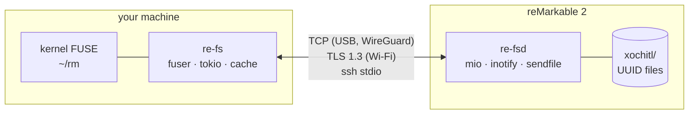

# re-fs wiki

re-fs shows a reMarkable 2's documents as an ordinary folder tree on your computer.
A small agent on the tablet (`re-fsd`) serves the tablet's document store; a client
(`re-fs`) mounts it with FUSE, caches files, renders handwriting to PDF, and turns
`mkdir`/`cp`/`mv`/`rm` into safe edits on the tablet.

## Pages

| Page | What it covers |
|---|---|
| [Usage](Usage) | Setup, transports (incl. what `--ssh` does), mounting, troubleshooting |
| [reMarkable storage format](Remarkable-Storage-Format) | How the tablet stores folders, documents, pages and strokes |
| [Architecture](Architecture) | The four crates, threads, data flow |
| [Wire protocol](Wire-Protocol) | Frames, messages, index deltas, change events |
| [Transports and security](Transports-and-Security) | USB, Wi-Fi (TLS with ssh keys), WireGuard, ssh; the tablet service |
| [Rendering](Rendering) | v5/v6 stroke parsing, notebooks, annotated PDFs, highlights |
| [Writes and plans](Writes-and-Plans) | How filesystem actions become tablet edits |
| [Caching and offline](Caching-and-Offline) | Downloads, generated files, the saved index |
| [Build and cross-compilation](Build-and-Cross-Compilation) | Nix, crane, armv7 musl, ring, the optional OpenSSL backend; `tools/build.sh` without Nix |
| [Design decisions](Design-Decisions) | Every decision, the alternatives, and why |
| [Measurements](Measurements) | Benchmarks taken on the real tablet |
| [Testing](Testing) | What the tests cover and how to run them |
| [Plan: incremental PDFs](Plan-Incremental-PDF) | Parked: annotated PDFs that load while you scroll (PDF incremental update) |

Repository: `ssh://git@forge.example/user/re-fs.git`.
