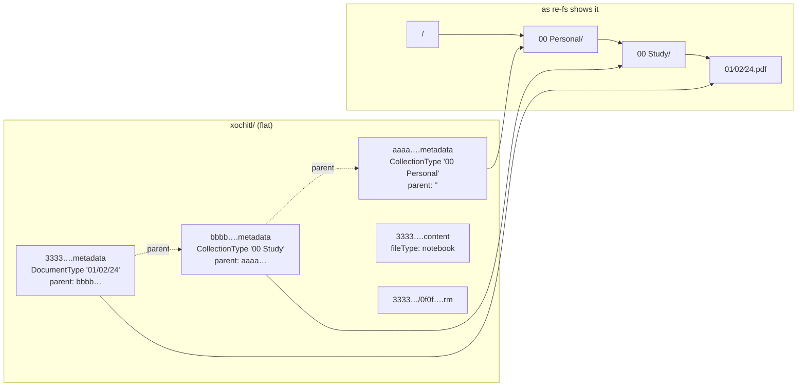
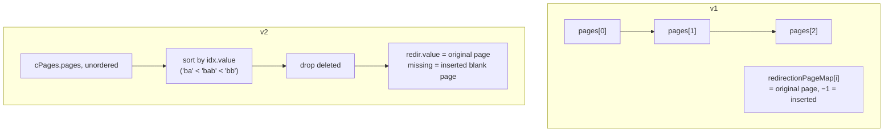

# reMarkable storage format

Everything here was measured on a reMarkable 2 (OS build 20260827113527) in October
2026, over SSH, read-only. At the time the tablet held 380 items: 329 documents
(191 notebooks, 106 PDFs, 32 EPUBs) and 51 folders, nested at most 4 deep, with 31
items in the trash.

## One flat directory

All documents live in a single directory:

```
/home/root/.local/share/remarkable/xochitl/
```

There are no real folders on disk. Each folder and each document is a group of files
that share a UUID prefix, and the folder tree only exists as `parent` pointers in
JSON.

| File | Holds |
|---|---|
| `<uuid>.metadata` | Name, type (folder or document), parent, timestamps, pinned, deleted. **This is the tree.** |
| `<uuid>.content` | File type, page list and order, PDF page mapping, tags, zoom and text settings |
| `<uuid>/<page-id>.rm` | Strokes for one page; only exists for pages with writing |
| `<uuid>/<page-id>-metadata.json` | Layer names for that page |
| `<uuid>.pdf` / `<uuid>.epub` | The imported original, without annotations |
| `<uuid>.pagedata` | Template name per page |
| `<uuid>.local` | Local state, e.g. `{"contentFormatVersion": 2}` |
| `<uuid>.thumbnails/<page-id>.png` | Page previews as xochitl draws them |
| `<uuid>.epubindex`, `.textconversion`, `.highlights/` | EPUB layout index, handwriting conversion, old-style highlights |

EPUB documents also have a `<uuid>.pdf` next to them: the tablet's own rendering of
the EPUB. re-fs doesn't expose it.



## `.metadata`

```json
{
    "createdTime": "1701093565557",
    "lastModified": "1701100163735",
    "lastOpened": "1701093565876",
    "lastOpenedPage": 5,
    "parent": "22222222-2222-4222-8222-222222222222",
    "pinned": false,
    "type": "DocumentType",
    "visibleName": "01/02/24"
}
```

- `type`: `CollectionType` (folder) or `DocumentType`.
- `parent`: a folder's UUID, `""` for the top level, or `"trash"`.
- Timestamps are milliseconds, usually as strings, sometimes as numbers.
- `deleted: true` items are gone; xochitl keeps the file around.
- Older items also carry `metadatamodified`, `modified`, `synced`, `version` (sync
  bookkeeping); recent imports carry `new` and `source` instead.
- Names can contain anything: `/`, `:`, non-breaking spaces, trailing spaces.
- 34 of 329 imported documents keep their original filename as `visibleName`
  (`paper.pdf`), so a viewer must not add `.pdf` twice.

On the surveyed tablet every parent pointer was valid: no orphans, no cycles, no
document used as a parent. re-fs still handles all three (see
[Architecture](Architecture)).

## `.content`

`fileType` is `pdf`, `epub`, `notebook`, or empty (older notebooks). The rest is the
page list, in one of two formats. Both were in use on the same tablet; documents last
edited before OS 3 keep the old one.

**v1** (197 documents): a plain list in page order, plus a map from position to
original PDF page.

```json
"pages": ["571bb61b-…", "8dc3e414-…"],
"redirectionPageMap": [0, 1, 2]
```

**v2** (132 documents): a CRDT-style list. Every value is wrapped as
`{"timestamp": "1:2", "value": …}`.

```json
"cPages": { "pages": [{
  "id": "9dfb475b-…",
  "idx":   { "timestamp": "1:1", "value": "ba" },
  "redir": { "timestamp": "1:1", "value": 0 },
  "template": { "timestamp": "1:1", "value": "Blank" }
}] }
```



- `idx.value` strings sort in page order and let pages be inserted between others
  without renumbering.
- 24 v2 entries were marked `deleted`.
- 87 pages across the tablet's PDFs were blank pages inserted on the tablet (no
  `redir`).
- A listed page without a `.rm` file has no writing on it. Every one of the 2,714
  `.rm` files on the tablet was listed in its document's `.content`.

Other fields re-fs reads: `pageCount`, and `tags` (newer files: objects with `name`,
older: plain strings).

## `.rm` stroke files

Each file starts with a 43-byte text header:
`reMarkable .lines file, version=N` padded with spaces. On the surveyed tablet 1,384
pages were **v5** (written under OS 2, untouched since) and 1,330 were **v6**.

### v5 (and v3): fixed layout

```
header (43 bytes)
layers: u32
  per layer: lines: u32
    per line: tool u32, color u32, padding u32, thickness f32,
              unknown u32 (v5 only), points u32
      per point: x f32, y f32, speed f32, direction f32, width f32, pressure f32
```

Coordinates are tablet pixels, x from the left edge (0..1404), y from the top
(0..1872). The v5 eraser paints white over what's beneath.

### v6: tagged CRDT blocks

A sequence of blocks, each with an 8-byte header:

```
len: u32 | unknown: u8 | min_version: u8 | version: u8 | type: u8 | body (len bytes)
```

Inside a body, every field is preceded by a varint tag `(index << 4) | type`, where
type is `0xF` (CRDT id: u8 + varint), `0xC` (length-prefixed sub-block), `0x8`
(8 bytes), `0x4` (4 bytes) or `0x1` (1 byte).

| Block type | Meaning | Used by re-fs |
|---|---|---|
| 0x01, 0x02, 0x04 | scene tree, tree nodes (layers), groups | skipped |
| 0x03 | glyph item: a text highlight | yes |
| 0x05 | line item: a stroke | yes |
| 0x06, 0x07 | typed text | not yet |
| 0x08 | tombstone | skipped |
| 0x09, 0x0A, 0x0D | author ids, page info, scene info | skipped |

A **line item** body: parent id (1), item id (2), left (3), right (4), deleted length
(5, non-zero = tombstone), then sub-block 6 holding item type `0x03` and: tool (1),
colour (2), thickness scale f64 (3), starting length f32 (4), points sub-block (5),
then optionally timestamp, move id, and an explicit ARGB colour (8) on newer
firmware.

Points in block version ≥ 2 are 14 bytes:

```
x f32 | y f32 | speed u16 | width u16 (×4) | direction u8 | pressure u8
```

Version 1 points are six f32s (24 bytes). Decoding the first point of a real stroke
(a sample page) gave x = −486.8, y = 227.1: **v6 x is relative to the
page's centre line**, so the page position is x + 702.

A **glyph item** (highlight) holds start (2), length (3), colour (4), the highlighted
text (5, a sub-block: varint length, is-ascii byte, UTF-8 bytes) and its rectangles
(6: varint count, then x, y, w, h as f64 each).

In v6, erasing removes the erased strokes; the eraser's own path can remain as a
stroke with the eraser tool. It must not be drawn (an earlier re-fs drew it white
and blanked out PDF text).

Tool ids, shared by both versions (v6 adds a "v2" range): ballpoint 2/15, fineliner
4/17, marker 3/16, pencil 1/14, mechanical pencil 7/13, paintbrush 0/12, calligraphy
21, highlighter 5/18, shader 23, eraser 6, erase area 8. Colours: 0 black, 1 grey,
2 white, 3 yellow, 4 green, 5 pink, 6 blue, 7 red, 8 grey overlap, 9–12 highlighter
colours.

## Coordinates on PDF pages

Notebook pages are 1404 × 1872 px at 226 dpi, but they're an open canvas: a real
inserted page had strokes from y = −245 to y = 2266.

On **PDF pages**, strokes are stored at the tablet's physical resolution, independent
of the zoom they were drawn at:

- 1 px = 72/226 pt,
- x relative to the PDF page's centre line,
- y down from the page's top.

So a point (x_px, y_px) lands at `x_pt = page_w/2 + (x_px − 702)·72/226` and
`y_pt = y_px·72/226` from the top. Two other models (page fitted to the screen's
width; page fitted to the whole screen, centred) were tried and both put the ink
visibly in the wrong place; the physical model matched xochitl's own thumbnails of a
real annotated A4 page stroke for stroke. See [Rendering](Rendering).

## The trash

Trashed items keep their files and get `parent: "trash"`. Deleting from the trash on
the tablet sets `deleted` or removes the files. A folder in the trash hides its whole
subtree.

## `.rmdoc`

reMarkable's own export format: a zip of one document's files, named as on the
tablet.

```
<uuid>.metadata
<uuid>.content
<uuid>.pagedata        (if any)
<uuid>.pdf | .epub     (if any)
<uuid>/<page-id>.rm
<uuid>/<page-id>-metadata.json
```

re-fs writes them uncompressed (PDFs and strokes barely shrink).

## How xochitl reacts to outside writes

- Files written into `xochitl/` while it runs aren't noticed until it restarts
  (`systemctl restart xochitl`).
- After a restart it indexes new items and creates their `.local` files; `pageCount`
  stays 0 until the document is first opened.
- Moving an existing annotated notebook by rewriting only its `.metadata`, twice,
  across two restarts, left its stroke file byte-identical.

## Tablet quirks

- The shell is BusyBox: no `head -c`, no `pkill`; use `dd bs=N count=1` and `ps | grep`.
- SSH is Dropbear; an SFTP server exists at `/usr/libexec/sftp-server`.
- The CPU is a dual-core i.MX7 (Cortex-A7) with no AES instructions.
- The USB network gives the tablet `10.11.99.1/27` on `usb1`; the host gets an
  address in the same /27 (seen: `10.11.99.7`).
- OS updates reset `/etc`, so services installed there must be re-added afterwards.
