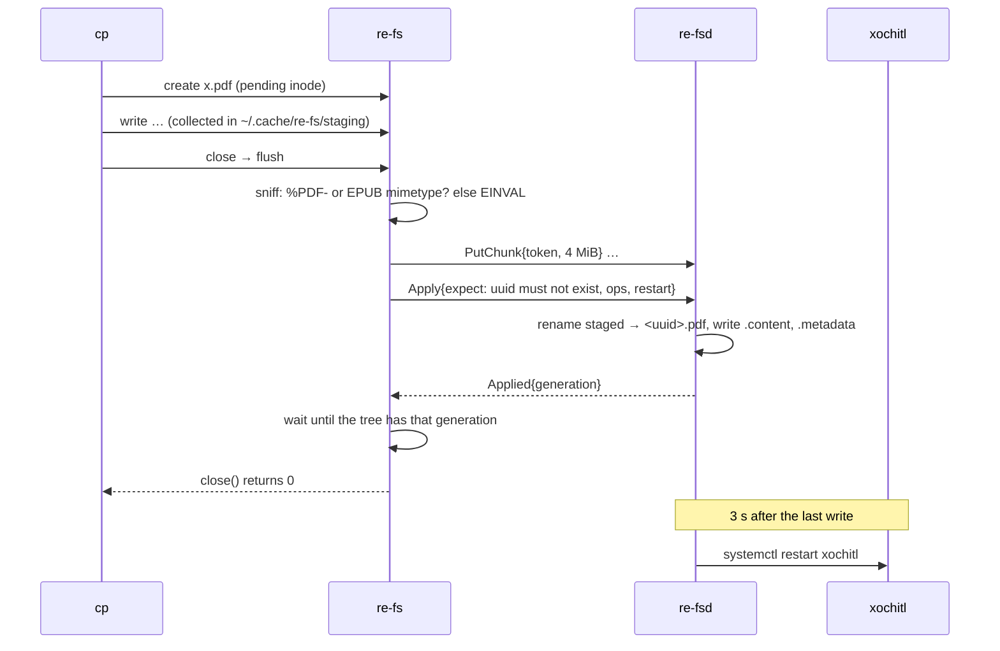

# Writes and plans

With `--rw`, filesystem actions on the main tree become edits on the tablet. Each
becomes a **plan**: a list of file writes plus preconditions, built by pure, tested
functions in `re_proto::index::plan`. The agent doesn't parse JSON; it checks the
preconditions and moves bytes into place.

| On your machine | On the tablet |
|---|---|
| `mkdir A` | new folder: `.content` `{"tags": []}`, then `.metadata` (CollectionType) |
| `cp x.pdf A/`, `cp y.epub A/` | new document: the file, a `.content`, then the `.metadata` |
| `mv A/x.pdf B/y.pdf` | `.metadata`: new `parent`, `visibleName`; other fields kept |
| `rm A/x.pdf`, `rmdir A` | `.metadata`: `parent = "trash"` (restore from the tablet's trash) |
| `re-fs push x.pdf --to A` | the same as `cp`, without a mount |

## Plans

```
Plan { expect: [Expect], ops: [Op], restart: bool }
Expect { uuid, metadata: None | Some((mtime_ms, size)) }   // must not exist / must be unchanged
Op::PutJson   { uuid, file: .metadata | .content, json }
Op::PutStaged { uuid, file: .pdf | .epub, token }          // a finished upload
```

The agent applies a plan atomically:

1. Check every precondition against the `.metadata` on disk; any mismatch → `Conflict`
   and nothing is written (the client returns `EAGAIN`).
2. Write data files first, then `.content`, then `.metadata`, each via a temporary
   file and `rename`, so an item appears only once it's complete.
3. Rescan the touched items, bump the generation, tell watchers.
4. If the plan asks, restart xochitl 3 s after the last such plan (one restart for a
   batch of copies). Only when serving the real xochitl directory.



Uploads are sent on `close()` (FUSE `flush`), not on `release`, so `cp` sees errors
as close's return value. A write returns once the mount shows its result: ~10 ms
locally, 40–100 ms over ssh on the LAN.

## Rules

- Only PDFs and EPUBs can be copied in; the contents are checked (PDF header, EPUB
  zip whose first entry is the stored `mimetype`). Anything else: `EINVAL`.
- Existing documents can't be overwritten or edited in place (it would misalign
  their annotations): `EEXIST`, or `EACCES` from the kernel for read-only files.
- The type's extension is shown, not stored: `mv x.pdf y.pdf` stores "y". Another
  extension is kept as typed (`mv x.pdf notes.epub` stores "notes.epub", shown as
  `notes.epub.pdf`).
- `rmdir` refuses folders that still hold anything, including notebooks not shown
  (it checks the raw entries, not the tree): `ENOTEMPTY`.
- A folder can't move into itself or below itself: `EINVAL`.
- Only primary documents (`X.pdf`, `X.epub`, a notebook's `X.pdf`) and main-tree
  folders accept writes; derived files and view folders: `EPERM`.
- Items already in `.trash` can't be deleted for good from here: `EPERM`.

New documents get the `.metadata` shape xochitl writes for imports (`createdTime`,
`lastModified`, `lastOpened`, `lastOpenedPage`, `new`, `parent`, `pinned`, `source`,
`type`, `visibleName`) and a minimal `.content`; xochitl fills in the rest when it
next starts. Edits update `lastModified`, set `metadatamodified`, and clear `synced`
when present.

Tested on the tablet with new items only, then by moving an existing annotated
notebook out of a folder and back: its stroke file stayed byte-identical across both
xochitl restarts.
